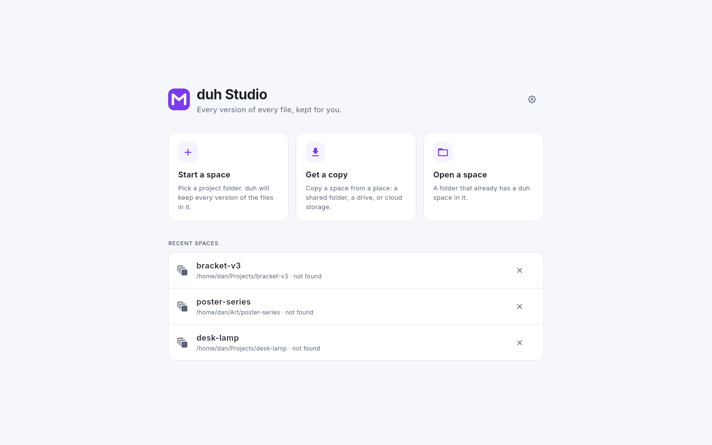
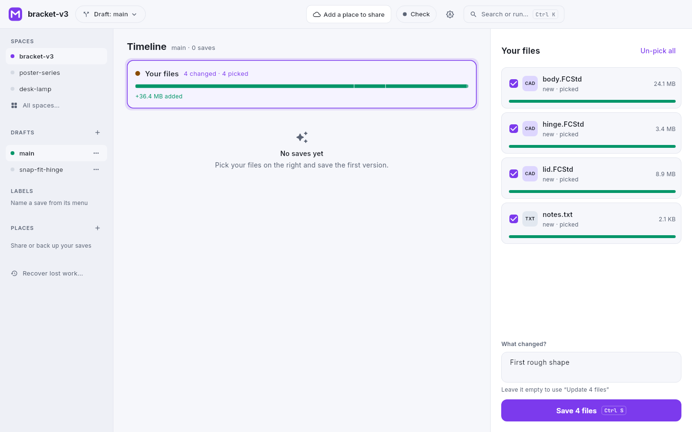
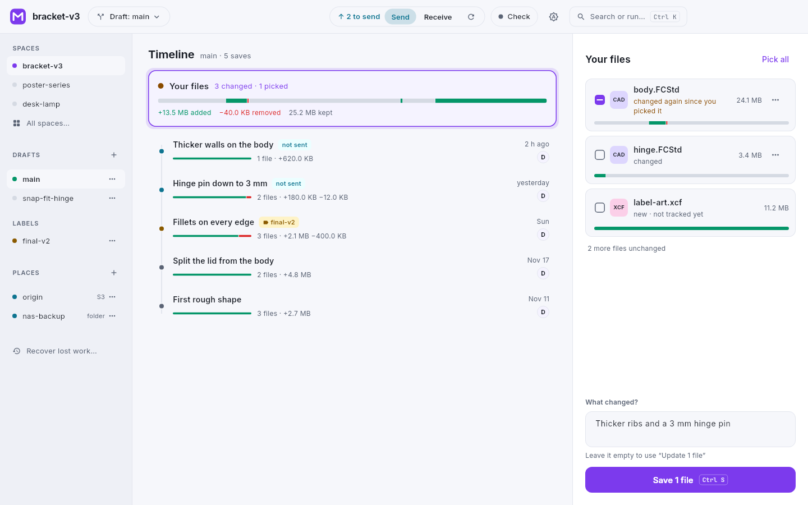
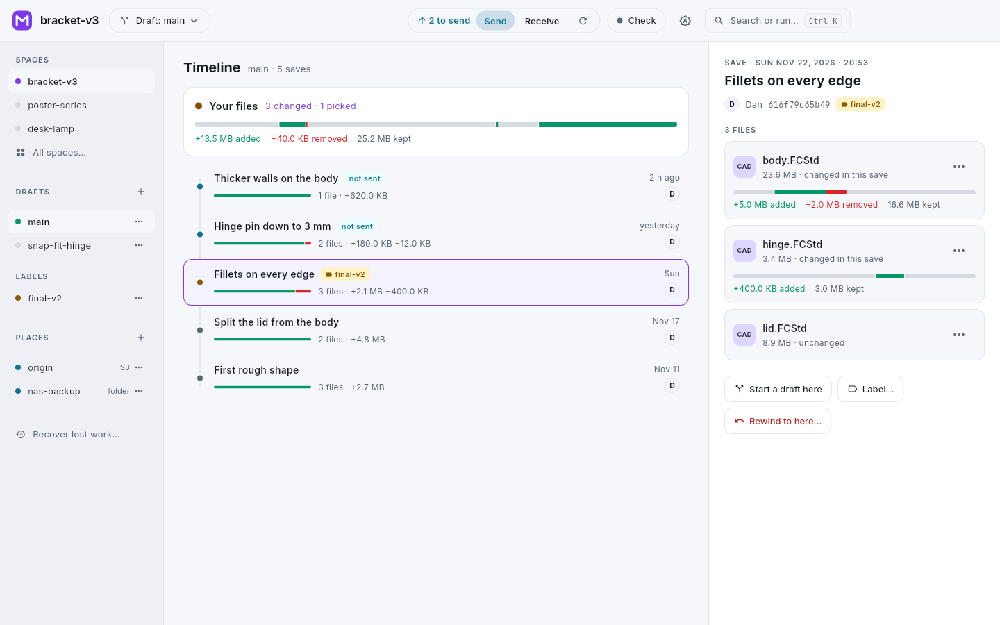
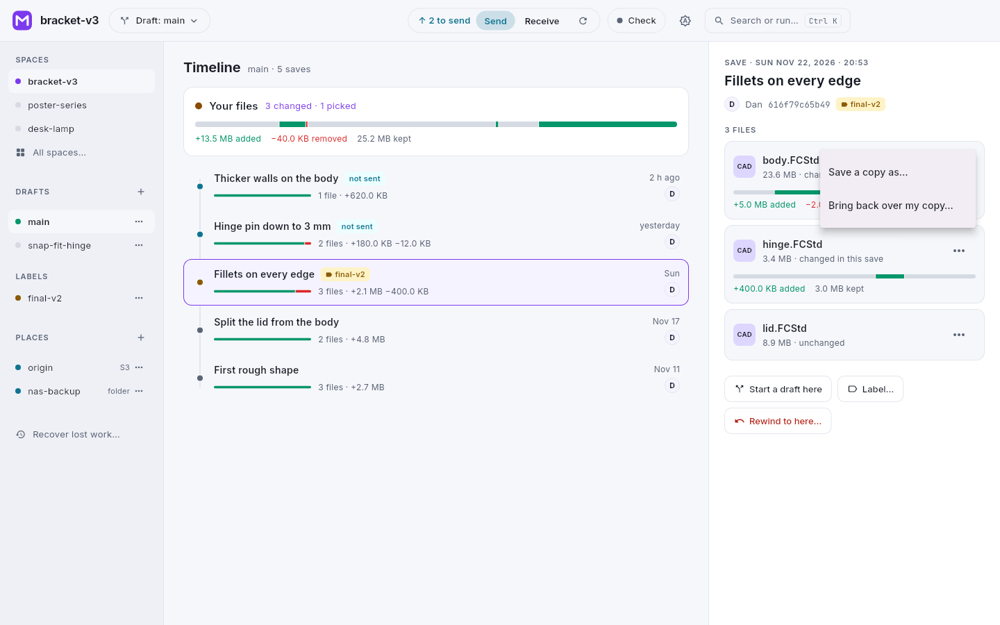
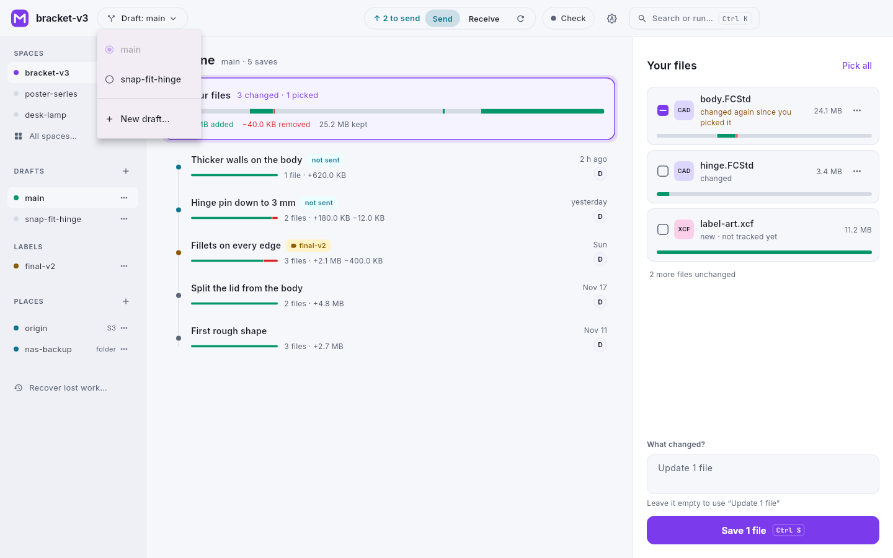
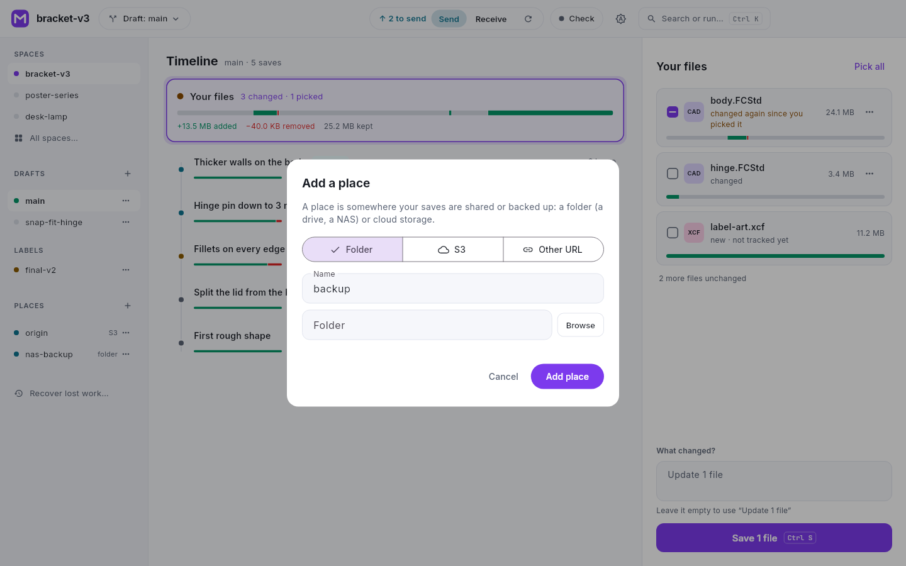
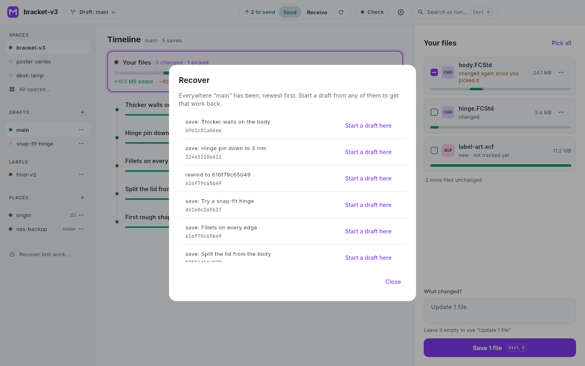
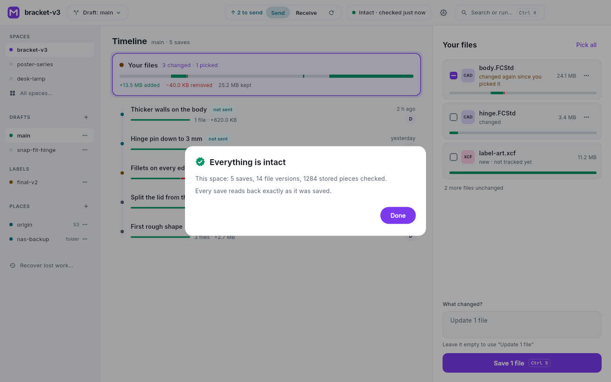

# Getting started

This walks one project from nothing to a shared, checked history: a
FreeCAD model of a bracket, in a folder called `bracket-v3`. Every step is
shown in **duh Studio**, the desktop app, and as the same command on the
command line. Use whichever you like; they work on the same space, even at
the same time.

You'll need duh installed: see [Install](../README.md#install). If you've
never used version control, [How duh works](concepts.md) explains the
ideas first, in a few minutes.

**The words duh uses:**

| Word | What it is |
|---|---|
| **space** | A folder whose files duh keeps every version of |
| **pick** | Choose which files go into your next save |
| **save** | A version of the files you picked, with a note about what changed |
| **draft** | A separate line of saves, for trying something without risking the main one |
| **label** | A name for one save, like `final-v2` |
| **place** | Somewhere a copy of your space lives: a folder, a drive, a NAS, cloud storage |

---

## 1. Start a space

Open duh Studio and choose **Start a space**, then pick your project folder.
duh puts a hidden `.duh` folder inside it, and that's where every version
will live. Your own files stay exactly where they are.



On the command line, from inside the folder:

```console
$ duh start
Started a new space here. `duh pick <file>` to begin tracking files.
```

Your saves are signed with your computer account's name. To use your
full name instead: `duh settings set user.name "Ana Lee"`.

## 2. Your first save

The right-hand side, **Your files**, lists everything in the folder that
isn't saved yet. Tick the files you want to keep versions of (or **Pick
all**), write what this version is in **What changed?**, and press
**Save** (Ctrl+S).



The green bar under each file is its *change strip*. For a new file it's
all green: every byte is new.

```console
$ duh look
On draft main

New, not tracked yet:
  body.FCStd
  hinge.FCStd
  lid.FCStd
  notes.txt

$ duh pick .
Picking .
-- Picking body.FCStd
Dif[++++++++++++++++++++++++++++++++++++++++++++++++++++++++++++]
  +24.1 MB
-- Picking hinge.FCStd
Dif[++++++++++++++++++++++++++++++++++++++++++++++++++++++++++++]
  +3.4 MB
-- Picking lid.FCStd
Dif[++++++++++++++++++++++++++++++++++++++++++++++++++++++++++++]
  +8.9 MB
-- Picking notes.txt
Dif[++++++++++++++++++++++++++++++++++++++++++++++++++++++++++++]
  +37 B

$ duh save -m "First rough shape"
[main 0ce74f8e77da] First rough shape
```

## 3. Work, then save again

Go back to work. When you save `body.FCStd` in FreeCAD, duh notices. The
top card in the timeline, **Your files**, shows what's changed since your
last save, and each file's strip shows *where*: green was added, red was
removed, grey is unchanged.



A save only stores the parts that changed. Thickening one wall of a 24 MB
model costs about as much as the edit itself: below, 24 KB, not another
24 MB.

```console
$ duh look
On draft main

Changed, not picked:
  body.FCStd

Saved, unchanged:
  hinge.FCStd
  lid.FCStd
  notes.txt

$ duh compare
body.FCStd
Dif[=================-+=========================================]
  +23.8 KB  -23.8 KB  =24.1 MB

$ duh save -a -m "Thicker walls on the body"
-- Picking body.FCStd
Dif[=================-+=========================================]
  +23.8 KB  -23.8 KB  =24.1 MB
[main 9298ff3be620] Thicker walls on the body
```

On the command line the strip is a bar of 60 columns: `=` kept, `-`
removed, `+` added, with the totals under it. `save -a` picks every
tracked file that changed, so you don't have to pick them one by one.

## 4. Look back

Click any save in the timeline to see it: who saved it, when, every file in
it, and how each one changed.



From here you can:

- **Label…** give it a name you'll remember, like `final-v2` or
  `sent-to-printer`;
- **Start a draft here** to try something new from this point;
- **Rewind to here…** move your draft back to this save (it asks first,
  and nothing is lost: see [Recover lost work](#8-recover-lost-work)).

```console
$ duh history --oneline
9298ff3be620 Thicker walls on the body
0ce74f8e77da First rough shape

$ duh label final-v1
Labelled 9298ff3be620 as final-v1
```

## 5. Bring back an old version

Open a save, then the **⋯** menu next to a file:

- **Save a copy as…** puts that version beside your work, under a new name.
  This is the safe way to look.
- **Bring back over my copy…** replaces your file with that version.



```console
$ duh bring-back body.FCStd --from HEAD~1 --as body-before.FCStd
Brought back body.FCStd as body-before.FCStd
```

Versions can be named by label (`final-v1`), by draft (`main`), by the
start of their hash (`b9b1c81a`), or relative to the latest save: `HEAD~1`
is the one before it.

## 6. Try things on a draft

Want to try a snap-fit hinge without touching the version that works? Open
the draft menu at the top and choose **New draft…**. Your saves now go on
the new draft; `main` stays where it was. Switch back any time from the
same menu.



```console
$ duh open --new snap-fit-hinge
Opened draft snap-fit-hinge

$ duh drafts
  main
* snap-fit-hinge
```

duh never merges. If the experiment works, keep going on that draft, or
bring its files back into `main` with step 5.

## 7. Share and back up

A *place* is anywhere a copy of your space can live: a folder on a USB
drive or NAS, or cloud storage like S3. There's no server to run. Choose
**Add a place** (in the sidebar, or with Ctrl+K), then **Send** to copy
your saves there and **Receive** to get other people's.



```console
$ duh places add usb /media/usb
Added the place usb at /media/usb. `duh send usb` copies your saves there.

$ duh send usb
Sent main -> usb/main (nothing..9298ff3be620): 2 saves, copied 26 stored pieces (36.4 MB)
```

Someone else gets their own copy with **Get a copy** on the welcome screen,
or `duh get /media/usb bracket-v3`. Sending never throws away anyone's saves
unless you force it, and receiving never runs over unsaved work.

More on places, including cloud storage, is in the
[README](../README.md#sharing).

## 8. Recover lost work

Every time a draft moves (a save, a rewind, a receive), duh writes it down
in the draft's *journal*. If you rewind too far or lose track of an
experiment, choose **Recover lost work…** in the sidebar: pick the moment
you want back and **Start a draft here**.



```console
$ duh journal
0ce74f8e77da  save: First rough shape
9298ff3be620  save: Thicker walls on the body
```

## 9. Check that everything is intact

**Check** at the top reads every stored piece, rebuilds every version of
every file, and confirms each one is byte for byte what you saved. Run it
on a place too, before you trust a backup.



```console
$ duh check
  checking stored pieces…
  checking every file at every save…
  checking picked files…
  checking solid copies…
Checked 26 stored pieces, 2 saves, 5 file versions, 0 picked files and 0 solid copies.
Everything is intact: every save reads back exactly as it was saved.
```

---

## Next

- Ctrl+K in Studio finds every action by name.
- `duh <command> --help` lists every option on the command line.
- A `.duhignore` file keeps files out of `look` and `pick`: one pattern per
  line, like `*.FCBak` or `renders/`, and `!` to let one back in.
- If you know git: every git command name works in duh too. The
  [README](../README.md#the-command-line) has the full list.
