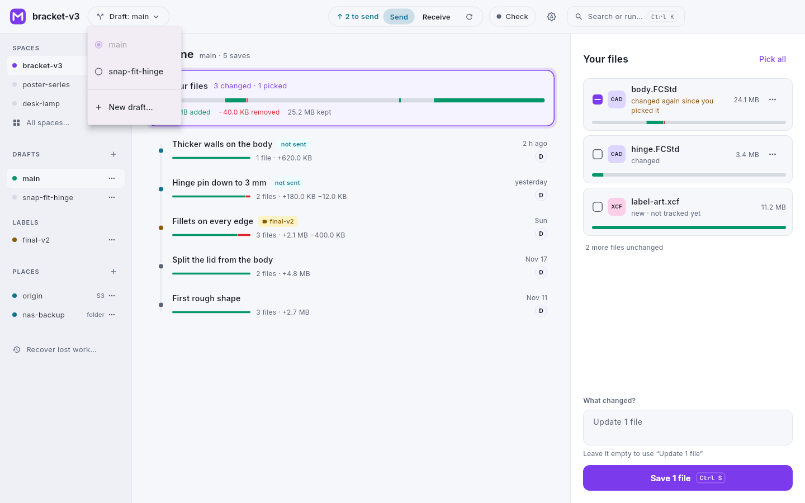

# Drafts

A **draft** is a line of saves. Every space starts with one called
`main`. Make another when you want to try something without risking the
version that works: a different hinge design, a new colour scheme, a
client's "could we just see it in blue?".

Saves on a draft only affect that draft. Switching drafts swaps your files
to match, so you're always working on exactly one of them.

## Start a draft and work on it

In duh Studio, open the draft menu at the top of the window and choose
**New draft…**. It starts from where you are and opens straight away.



On the command line:

```console
$ duh open --new snap-fit-hinge
Opened draft snap-fit-hinge
$ duh drafts
  main
* snap-fit-hinge
```

Now save as usual. Your saves go on `snap-fit-hinge`; `main` stays at the
save you started from.

To start a draft somewhere else, from an older save, say, without
opening it yet:

```console
$ duh drafts before-fillets final-v1
```

In duh Studio, click the save in the timeline and choose
**Start a draft here**.

## Switch between drafts

```console
$ duh open main
Opened draft main
```

In duh Studio, pick the draft from the draft menu or the sidebar.

Your files change to match the draft you open. Because of that, duh
won't switch while you have unsaved changes:

```console
$ duh open main
error: you have unsaved changes; save them, un-pick them or bring back your files before opening another draft
```

Save them on the current draft (they're safe there), or throw them away
with `duh bring-back <file>`.

## When the experiment works

duh never merges drafts. There's no automatic combining of two Blender
files, so duh doesn't pretend. You decide what continues:

- **Keep going on the new draft.** Nothing says `main` must be the one
  you use. Rename drafts if it helps: `duh drafts -m main-old` on `main`,
  then `duh drafts -m main` on the other.
- **Bring the files you want across.** On `main`, bring back a file as it
  is on the other draft, then save:

  ```console
  $ duh open main
  $ duh bring-back hinge.FCStd --from snap-fit-hinge
  $ duh save -a -m "Snap-fit hinge from the experiment"
  ```

- **Point `main` at the experiment's latest save.** If `main` hasn't
  moved since you started the draft, this makes them the same:

  ```console
  $ duh open main
  $ duh rewind snap-fit-hinge --discard
  ```

## When it doesn't

Open `main` again and carry on. The draft stays, in case you change your
mind. To remove it:

```console
$ duh drafts -d snap-fit-hinge
Deleted draft snap-fit-hinge
```

Deleting a draft only removes its name. If you need its saves later,
`duh journal -b snap-fit-hinge` still lists them; see
[Recover lost work](old-versions.md#recover-lost-work).

## All draft commands

| Command | Does |
|---|---|
| `duh drafts` | list drafts; `*` marks the open one |
| `duh drafts <name> [version]` | start a draft (at a version, default where you are) without opening it |
| `duh open <name>` | open a draft, making your files match it |
| `duh open --new <name>` | start a draft where you are and open it |
| `duh drafts -m <new name>` | rename the open draft |
| `duh drafts -d <name>` | delete a draft (not the open one) |
| `duh drafts -s <version>` | point the open draft at another save without touching your files (like `rewind`) |
