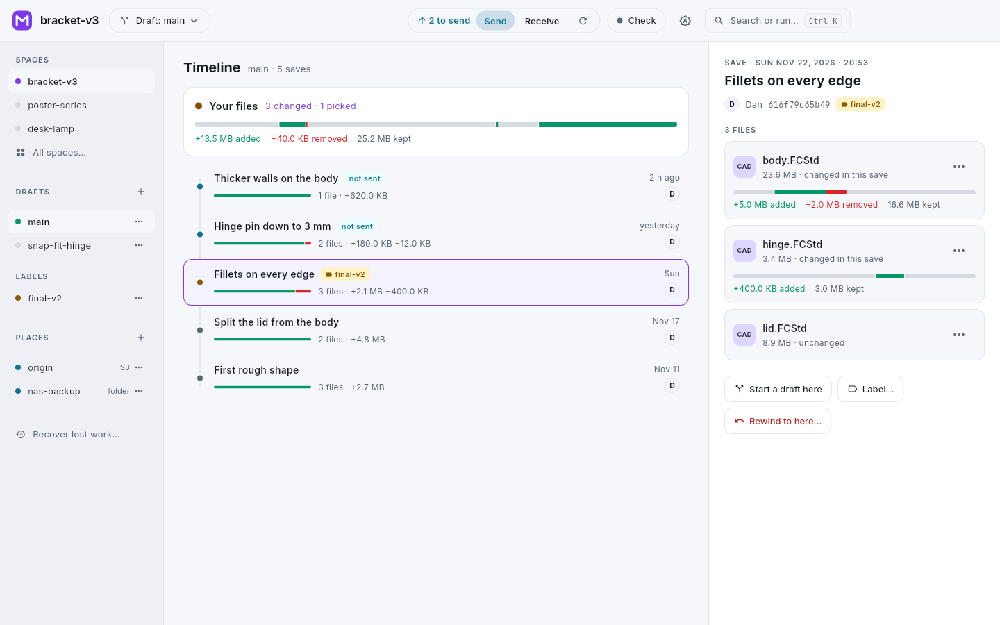
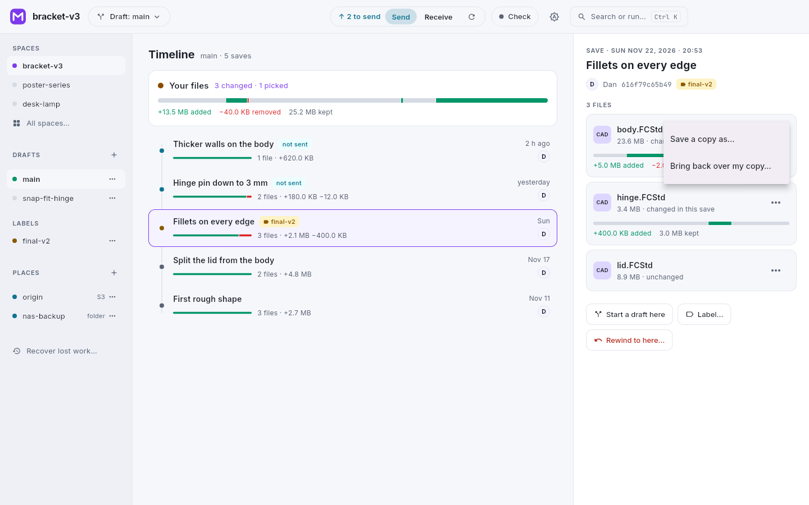
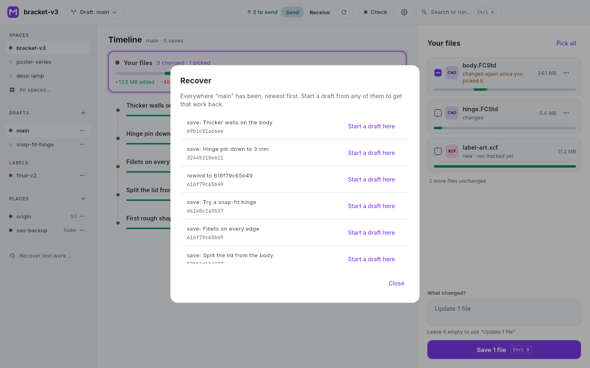

# Getting old work back

duh keeps every save. This guide covers every way of reaching one: looking
at it, copying a file out of it, putting a file back, undoing saves, and
recovering work you thought was lost.

**In short:**

| You want to… | In duh Studio | On the command line |
|---|---|---|
| see what a save contains | click it in the timeline | `duh inspect <version>` |
| get a copy of a file as it was | the file's **⋯** › **Save a copy as…** | `duh bring-back <file> --from <version> --as <new name>` |
| put a file back as it was | the file's **⋯** › **Bring back over my copy…** | `duh bring-back <file> --from <version>` |
| throw away edits since your last save | the file's **⋯** in **Your files** › **Bring back the saved version…** | `duh bring-back <file>` |
| undo saves | the save › **Rewind to here…** | `duh rewind <version>` |
| find work after a rewind or a deleted draft | **Recover lost work…** | `duh journal` |

## Naming a version

Anywhere duh asks for a version, any of these work:

| Write | Means |
|---|---|
| `final-v2` | the save with that label |
| `main` | the latest save on that draft |
| `9298ff3b` | the save whose hash starts with that (any length that's unique) |
| `HEAD` | your latest save on the draft you have open |
| `HEAD~1`, `HEAD~3` | one, three saves before it |
| `final-v2^` | the save before `final-v2` (same as `final-v2~1`) |

`duh history --oneline` lists saves with their short hashes:

```console
$ duh history --oneline
9298ff3be620 Thicker walls on the body
0ce74f8e77da First rough shape
```

## Look at a save

In duh Studio, click any save in the timeline. The right side shows its
note, who saved it and when, its labels, and each file in it with its
change strip. Alt+↑ and Alt+↓ step through saves.



On the command line, `duh inspect` shows the same:

```console
$ duh inspect HEAD~1
```

## Get a file as it was

The safe way is a copy beside your work, under a new name. Nothing you
have is touched:

```console
$ duh bring-back body.FCStd --from final-v1 --as body-final-v1.FCStd
Brought back body.FCStd as body-final-v1.FCStd
```

In duh Studio: open the save, click **⋯** next to the file, and choose
**Save a copy as…**. Studio suggests a name with the version in it.



To replace your file with that version instead, leave out `--as`, or
choose **Bring back over my copy…**. Studio asks first, because any
unsaved changes in that file are lost.

Bringing a file back doesn't change history. Your file is just different
from your last save now, so `look` lists it as changed. Save it if you
want that old version to be the newest.

## Throw away your unsaved edits

To put a file back the way it was at your last save:

```console
$ duh bring-back body.FCStd
```

If you'd picked the file, this brings back the picked version instead,
the one that would have gone into the next save. To go all the way back
to the last save, use `duh bring-back body.FCStd --from HEAD`, or
`duh unpick body.FCStd` first.

## Undo saves: rewind

**Rewind** moves your draft back to an earlier save, as if the later ones
hadn't happened on this draft. It's how you undo a save you didn't mean to
make. You choose what happens to your files:

| | Your draft | Your files | Picked |
|---|---|---|---|
| `duh rewind HEAD~1` | moves back one save | stay exactly as they are | nothing |
| `duh rewind HEAD~1 --keep-picked` | moves back one save | stay as they are | the undone changes, ready to save again |
| `duh rewind HEAD~1 --discard` | moves back one save | made to match that save | nothing; **unsaved edits are lost** |

Common uses:

- **Fix the last save's note, or add a forgotten file:**
  `duh rewind HEAD~1 --keep-picked`, pick anything else, then save again.
- **Abandon the last few saves completely:** `duh rewind HEAD~3 --discard`.

In duh Studio: click a save, then **Rewind to here…**. Studio explains
each option before doing anything.

The saves you rewind past aren't deleted. They're still in the journal,
below, and a draft can be started from any of them.

## Recover lost work

Every time a draft moves (a save, a rewind, a receive, being created),
duh writes the new position in that draft's **journal**. If a save seems
to have vanished, it's there:

```console
$ duh journal
0ce74f8e77da  save: First rough shape
9298ff3be620  save: Thicker walls on the body
616f79c65b49  rewind to 616f79c65b49
```

To get the work back, start a draft at the save you want:

```console
$ duh drafts recovered 9298ff3be620
$ duh open recovered
```

In duh Studio: **Recover lost work…** at the bottom of the sidebar (or
Ctrl+K, "Recover"). Pick the moment you want and choose
**Start a draft here**.



**Deleted a draft?** Its journal stays. `duh journal -b <draft name>`
lists where it was.

### What the journal can't recover

The journal records saves, not your files. Edits you never saved and
then threw away (with `--discard` or **Bring back over my copy**) are
gone. When in doubt, save first: saves are cheap, and you can rewind
them away later.

## Label the versions that matter

Give a save a name you'll recognise later:

```console
$ duh label final-v1
Labelled 9298ff3be620 as final-v1
$ duh label sent-to-printer HEAD~2
$ duh label                       # list labels
$ duh label -d sent-to-printer    # remove a label (the save stays)
```

In duh Studio: click a save, then **Label…**. Labels show in the sidebar;
click one to jump to its save.
