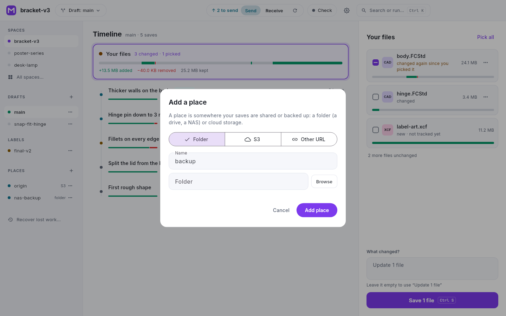

# Sharing and backups

A **place** is somewhere else a copy of your space lives. You **send**
your saves to it and **receive** saves from it. The same mechanism covers
backing up to a drive and working with other people.

There's no server to install or run. duh reads and writes the storage
directly: a folder, a USB drive, a NAS, or cloud storage.

## Back up to a drive or a NAS

1. Add the place. Give it a short name and say where it is:

   ```console
   $ duh places add usb /media/usb/bracket-v3
   Added the place usb at /media/usb/bracket-v3. `duh send usb` copies your saves there.
   ```

   The folder can be empty or not exist yet; it must not already hold
   other files.

2. Send:

   ```console
   $ duh send usb
   Sent main -> usb/main (nothing..9298ff3be620): 2 saves, copied 26 stored pieces (36.4 MB)
   ```

   The first send creates the space there. Later sends only copy what's
   new.

3. Check it, before you rely on it:

   ```console
   $ duh check usb
   Checking the place 'usb'
   ...
   Everything is intact: every save reads back exactly as it was saved.
   ```

In duh Studio: **Add a place to share** at the top (or the **+** beside
**Places** in the sidebar), choose **Folder** and **Browse** to it. Then
**Send**. The button shows how many saves are waiting to go.



The backup is a *bare* space: history only, no working files. To get your
files back from it, see [Get a copy](#get-a-copy).

## Cloud storage

The same, with a URL instead of a folder, and the storage's settings as
`-o key=value` options.

**Amazon S3**, or anything that speaks S3 (Backblaze B2, Cloudflare R2,
MinIO, Wasabi):

```console
$ duh places add cloud s3://my-bucket/projects/bracket-v3 \
    -o region=eu-west-1 \
    -o access_key_id=AKIA… -o secret_access_key=…
$ duh send cloud
```

For S3-compatible services that aren't Amazon, add
`-o endpoint=https://…` with the address your provider gives you.

In duh Studio, choose **S3** in **Add a place**: it asks for the bucket
and path, the endpoint (empty for Amazon), the region and the keys.

**Other storage**: duh can use any of these, through
[Apache OpenDAL](https://opendal.apache.org):

| Kind | URL schemes |
|---|---|
| Object storage | `s3`, `gcs`, `azblob`, `oss`, `obs`, `cos`, `b2`, `swift`, `upyun`, `supabase`, `vercel-blob`, `lakefs` |
| File protocols | folders and `file://`, `ftp`, `sftp` (not on Windows), `webdav`, `webhdfs`, `hdfs`, `azfile`, `azdls`, `dbfs`, `alluxio`, `ipmfs` |
| Cloud drives | `gdrive`, `onedrive`, `dropbox`, `pcloud`, `koofr`, `yandex-disk`, `aliyun-drive`, `seafile`, `icloud` |
| Read-only | `http`, `https`: `duh get` from a space on any web server |

The options each one takes are
[OpenDAL's names for that service](https://docs.rs/opendal/0.52.0/opendal/services/index.html),
for example `-o credential=…` for Google Cloud Storage or
`-o access_token=…` for Dropbox.

> **Credentials are stored in plain text** in `.duh/config`, inside your
> project folder. Don't share that folder with anyone who shouldn't have
> the keys, and prefer keys limited to the one bucket.

## Get a copy

Anyone who can reach a place can make their own copy of the space:

```console
$ duh get /media/usb/bracket-v3 bracket-v3
Got /media/usb/bracket-v3 -> bracket-v3
```

For cloud storage, give the same options as when adding it:

```console
$ duh get s3://my-bucket/projects/bracket-v3 -o region=eu-west-1 -o access_key_id=… -o secret_access_key=…
```

The new folder has every save, opens the same draft, and already has the
place added as `origin`, so `duh send` and `duh receive` work without
naming it.

In duh Studio: **Get a copy** on the welcome screen.

A space published on a web server can be copied straight from it:
`duh get https://example.com/bracket-v3/.duh my-copy`. Web places are
read-only.

## Send and receive

```console
$ duh send            # to origin
$ duh send usb        # to a named place
$ duh receive         # from origin
$ duh receive usb
```

In duh Studio, **Send** and **Receive** at the top use your first place.
The pill shows **↑** saves waiting to send and **↓** saves waiting to
receive; the **⟳** button checks again. Ctrl+K lists the same actions for
every place.

Two rules keep everyone's work safe:

- **Sending never throws away saves.** If the place has saves you don't,
  send stops:

  ```console
  $ duh send
  error: origin/main has saves you don't; `duh receive origin` first (or --force to discard them)
  ```

- **Receiving never runs over unsaved work, and never merges.** It only
  moves your draft forward:

  ```console
  $ duh receive
  error: you have unsaved changes; save or bring back your files before receiving
  ```

When you receive into the draft you have open, your files update to
match the new saves.

If you *and* the place both have new saves, see
[When both sides saved](working-together.md#when-both-sides-saved).

## Other drafts

`send` and `receive` use the draft you're on, with the same name on the
place. To use a different one:

```console
$ duh send origin --draft ana-colours            # your draft, as ana-colours there
$ duh receive origin --draft main --into review  # their main, into your draft review
```

## Manage places

| Command | Does |
|---|---|
| `duh places list` (`-v` for where each is) | list places |
| `duh places add <name> <url> [-o key=value]…` | add one |
| `duh places rename <old> <new>` | rename one |
| `duh places set-url <name> <url>` | point one somewhere else |
| `duh places get-url <name>` | show where one is |
| `duh places remove <name>` | forget one; nothing stored there is deleted |

To change a place's options later, use settings:
`duh settings set remote.cloud.config.region eu-central-1`.

## Starting a shared space from scratch

You don't need anyone's space to exist first. The first `send` to an
empty location creates it. To make an empty one by hand instead, run
`duh start --bare` inside the folder that will hold it.
