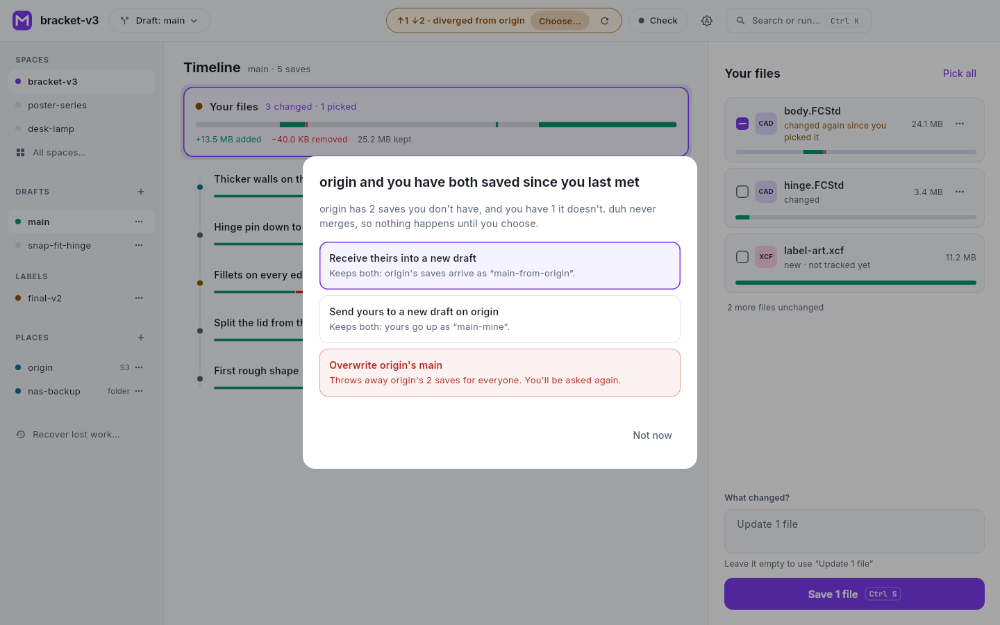

# Working together

Several people can work on one space through a shared place: a NAS, a
shared drive, or a cloud bucket everyone can reach. Each person has their
own copy, saves locally, and sends and receives through the place.

duh never merges. Two people can't both change the same draft and have
duh combine the results. That's deliberate: there's no meaningful way to
combine two edited 3D models or Photoshop files byte by byte, and a tool
that tried would quietly break them. Instead, duh makes sure nobody's
saves are ever lost, and leaves the choice to you.

## Setting up

One person creates the shared place by sending to it:

```console
$ duh places add origin /mnt/nas/poster
$ duh send
Sent main -> origin/main (nothing..f70c4073a0ff): 1 save, copied 5 stored pieces (2.0 MB)
```

Everyone else gets a copy:

```console
$ duh get /mnt/nas/poster poster
Got /mnt/nas/poster -> poster
```

Their copy already knows the place as `origin`.

## The everyday rhythm

1. **Receive** before you start: `duh receive`, or **Receive** in Studio.
2. Work and save as usual.
3. **Send** when you're done: `duh send`, or **Send** in Studio.

Studio shows where you stand at the top of the window: **↑2** means two
of your saves haven't been sent; **↓1** means someone else sent one you
haven't received.

## Ways to share a project

**Take turns on one draft.** Simplest for small teams: agree who's
working on the project (or on which files) at the moment. Receive before
you start, send when you stop. Nobody's saves ever collide.

**A draft each.** Everyone saves on their own draft and sends it under
their own name. Nobody can block anybody:

```console
$ duh open --new ben
$ duh save -a -m "Bigger title"
$ duh send          # creates origin/ben
```

Anyone can look at anyone's draft by receiving it into one of their own:

```console
$ duh receive origin --draft ben --into ben
```

One person then brings the finished files into `main`
([how](drafts.md#when-the-experiment-works)).

**One file per person.** If each person owns different files (Ana the
poster layout, Ben the illustrations), they can share one draft and still
rarely collide. When they do, it's handled as below.

## When both sides saved

Ana and Ben both start from the same save. Ben saves and sends first.
Ana saves too, then tries to send:

```console
$ duh send
error: origin/main has saves you don't; `duh receive origin` first (or --force to discard them)
$ duh receive
error: your draft 'main' has saves that origin/main doesn't; duh doesn't merge, so it only receives when nothing would be lost
```

The drafts have **diverged**: each side has a save the other doesn't.
Nothing has been lost, and nothing will happen until Ana chooses. Studio
shows it at the top, and **Choose…** explains the options:



**1. Receive theirs into a new draft.** Keeps both. Ben's saves arrive
beside Ana's:

```console
$ duh receive origin --draft main --into ben
Received origin/main -> ben (nothing..7e7694aaa038): 2 saves (nothing new to copy)
```

Now Ana can open `ben`, compare, bring across whichever files she needs
([how](drafts.md#when-the-experiment-works)), and save the combined
result on `main`. If Ben's version is simply the right one, she can make
`main` match it.

**2. Send yours to a new draft on the place.** Also keeps both, the other
way round. Ana's saves go up beside Ben's, for Ben (or whoever decides)
to sort out:

```console
$ duh send origin --draft ana-colours
Sent main -> origin/ana-colours (nothing..28f037a0e64f): 2 saves, copied 8 stored pieces (4.9 KB)
```

**3. Overwrite the place's draft.** Throws away Ben's saves *on the
place*: only do this if you're sure they shouldn't be there. Ben still
has them on his own computer.

```console
$ duh send --force
```

## Good habits

- **Receive before you start, send when you stop.** Most divergence comes
  from forgetting one of these.
- **Write notes that say what changed**, so others can tell saves apart:
  "Bigger title, same layout" beats "update".
- **Label what you hand over:** `duh label sent-to-client-v3`. Labels
  stay on your own computer for now (sending doesn't copy them), so say
  in the save's note too.
- **Check the shared place now and then:** `duh check origin` reads back
  every save stored there.
- **Keep keys out of shared folders.** Credentials for a place live in
  plain text in `.duh/config`; see
  [Sharing and backups](sharing.md#cloud-storage).
