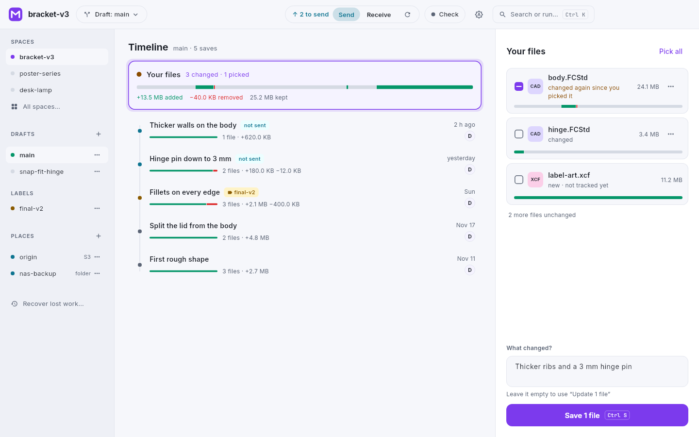

# duh Studio

duh Studio is duh's desktop app. It runs the same engine as the command
line, so the two always agree, and you can use both on one space at the
same time.

- **Linux:** the AppImage from the
  [releases](https://github.com/danhab99/duh/releases), or `nix run .#studio`,
  or Home Manager ([Install](../../README.md#install)).
- **Windows 10 and 11:** `duh-studio-x86_64-windows.exe` from the
  releases. One file: the first start unpacks it into
  `%LOCALAPPDATA%\duh-studio`, later starts reuse that. It isn't signed
  yet, so SmartScreen warns the first time: **More info**, then
  **Run anyway**.
- **macOS:** not available yet.

To open a folder straight away, pass it on the command line:
`duh-studio ~/Projects/bracket-v3`.

## The window

**Top bar**, left to right:

- the space's name, and the **draft menu**: switch drafts, or
  **New draft…**;
- the **sync pill**: **↑** saves waiting to send, **↓** saves waiting to
  receive, **Send** and **Receive**, and **⟳** to look again. With no
  place yet it reads **Add a place to share**. When you and the place
  have both saved, it turns amber and offers **Choose…**;
- **Check**: proves every save reads back exactly; shows when it last ran;
- the **appearance** button: follow the system, dark, or light;
- **Search or run…** (Ctrl+K): every action by name.

**Sidebar:** your spaces (**All spaces…** for the full list), drafts,
labels and places (each with a **⋯** menu, and **+** to add), and
**Recover lost work…**.

**Timeline**, in the middle: **Your files** at the top, the work you
haven't saved, then every save on the draft, newest first. Each save shows
its note, its change strip, how many files changed and by how much, its
labels, and **not sent** if it hasn't gone to your place yet. Click one to
open it on the right.

**Right side:** either **Your files** or the save you clicked.

- **Your files** lists what changed since your last save. Tick files to
  pick them (**Pick all** / **Un-pick all**), write **What changed?**,
  then **Save** (Ctrl+S). Leave the note empty to use the suggested one
  shown below it. A file's **⋯** menu can bring back its saved version.
- **A save** shows its note, who saved it and when, its labels, and every
  file with its change strip. Each file's **⋯** menu offers **Save a copy
  as…** and **Bring back over my copy…**. Below: **Start a draft here**,
  **Label…** and **Rewind to here…**.

## Change strips

Every file and save has a bar showing *where* it changed: green added,
red removed, grey unchanged. A small change in a big file always gets at
least a sliver, so it never disappears.

## Keyboard

| Keys | Does |
|---|---|
| Ctrl+K | search for any action |
| Ctrl+S | save what's picked |
| Ctrl+R | look for changes again |
| Alt+↑ / Alt+↓ | step through the timeline |
| ↑ / ↓, Enter | move through and run search results |
| Esc | close a dialog or the search |

## Search (Ctrl+K)

Type a few letters of what you want. Actions include saving, picking all
changed files, sending to and receiving from each place, adding a place,
checking, starting a draft, opening any draft, going to any label,
recovering lost work, switching appearance, looking again, and switching
to any space.

## Where Studio keeps its settings

Studio's own settings (appearance and recently opened spaces) live in:

- Linux: `~/.config/duh-studio/` (or `$XDG_CONFIG_HOME/duh-studio/`);
- Windows: `%APPDATA%\duh-studio\`.

Each space's settings (your name on saves, places) live in that space's
`.duh/config`, shared with the command line. See
[Big files and settings](../guides/settings.md).

## Working alongside the command line

Studio notices changes made outside it, whether by your other programs or
by `duh` in a terminal, and updates within a moment. Ctrl+R looks again
straight away. duh lets only one save, send or similar change happen to
a space at a time, so the app and the command line can't trip over each
other; one waits for the other.
